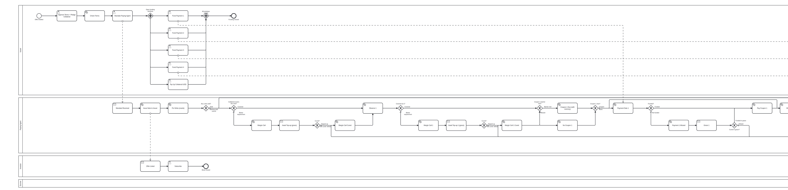
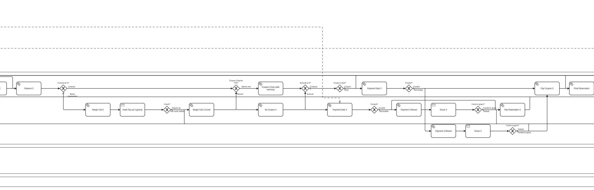
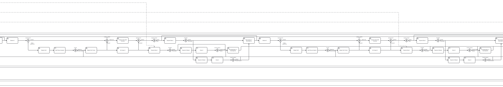

# Note economics: funds raised against pledged collateral

A structured note is a way for the issuer to raise money. Investors pay the issue price and the issuer may use that
money at once. In return the issuer promises the payoff: coupons and a redemption that depend on prices. What keeps
the promise is collateral the issuer pledges, and the obligation to fund each payment before it falls due. This is
how StratosNotes runs every note, and all of it is drawn in the note's BPMN workflow, where the validator, the
canvas, the AI and the engine see it.

## The cycle

| When | What happens | Who acts | Where in the workflow |
|---|---|---|---|
| Pre-trade | The issuer sets this issuance's terms: size, strike and observation dates, **settlement lag**, **grace period** (0-7 days), **collateral ratio** and a **haircut** per collateral asset, and **pledges collateral**. It is deposited and moved into the note's **escrow** in the same transaction. The engine refuses terms out of range (grace above 7 days, haircuts outside 0-100%, a payment deadline after the next observation). | Issuer | `Task_ApproveTerms` (milestone *collateral pledged*), `Task_CheckTerms` |
| Book open | Investors pay the issue price in stablecoin and receive note units in one atomic swap. **The stablecoin goes to the issuer**, withdrawable at once. | Investors | `Task_Subscribe` |
| Strike | CRE fixes the strikes and prices the collateral. Unsold units are cancelled. The requirement is `ratio x units sold`; coverage is `sum of escrowed amount x price x haircut`. | Chainlink CRE | `Task_FixStrike`, margin check |
| Margin | At the strike and at every observation: coverage below the requirement opens a **margin call**. The issuer tops up within the grace period, or the note **defaults**. | CRE, issuer | `GW_Margin*`, `Task_MarginCall*`, `Recv_MarginCure*`, `Task_TopUp_*` |
| Each observation k | CRE observes; the workflow fixes what period k owes per unit: the coupon (or nothing), plus the redemption on an autocall or at maturity, or the underlying's token for physical settlement. | Chainlink CRE | `Task_Observe*`, coupon and autocall gateways |
| Payment date k = observation k + lag | The issuer must have funded period k into escrow through **Fund Payment k** (any time before; in several deposits if it likes). The payment date checks the escrow: **funded** -> holders are paid from escrow. | Issuer, then the engine | `Task_Fund*` (milestone *funding deposited*), `S_Due*`, `GW_Funded*`, `Task_Pay*` (*payment made*) |
| Grace | **Not funded** -> *payment missed*, and the grace period runs. Funded within it -> paid at once (cured). | Issuer | `Task_Missed*`, `Recv_Grace*`, `GW_Cured*` |
| Default | Still unfunded when grace ends (or a margin call not cured): the holders are paid from escrow pro rata to their units, under the note's **default rule** (below): by default **what they are owed** (stablecoin first, then collateral in kind at its last Chainlink price), with the rest back to the issuer. The note ends **Defaulted**. | The engine | `Task_Default` (*defaulted*), `End_Defaulted` |
| After the final payment | **Release Collateral**: escrow goes back to the issuer. | The engine | `Task_Release` (*collateral released*), `End_Closed` |

The escrow is a pool in the workflow marked `escrow`. The engine holds its account at an address no key controls
(`FlowEngine.ESCROW`): nobody can withdraw from it, claim it at the start, transfer units to it, or act in it. Only the
workflow's own operations move its balances. Every payment to holders is paid **from escrow**, and the validator
refuses any payment that is not: it must be reached, on every path, through a deadline and a "Funded?" gateway that
tests `balance(Escrow, <asset>)`, with a default branch. That holds for canvas edits and AI drafts as well.

**The default rule** is one switch per product, `defaultRule` in the term sheet (the product form asks "On a
default, holders get"):

- `cap-at-owed` (**the default**): the holders take what they are owed, and no more. Owed = the missed payment
  (what period k owes per unit x units sold) plus par on every unit sold; when the missed payment is a cash
  redemption it already includes par, so par is not added twice (a physical delivery still owes par). The engine
  takes it from escrow in order: the stablecoin (partial funding included), then each collateral asset valued at its
  last Chainlink price, at market (no haircut). Whatever is left, cash and collateral, is transferred back to the
  issuer in the same transaction.
- `all-to-holders`: everything in escrow goes to the holders, whatever it is worth.

The two only differ when the escrow is worth more than what is owed, i.e. when the issuer pledged well above a
100% ratio, or collateral rose in value. A margin default owes par (no payment was due yet).

**A late funding call is refused.** Each Fund Payment window closes at its deadline (payment date + grace). After
that the engine reverts the issuer's call (`WindowClosed`) instead of taking nothing silently; only the engine
itself (a report or `poke`) moves the note on.

**Partial funding is not paid as a partial coupon.** When grace ends with less than the amount due in escrow, the
note defaults and the partial funding is distributed together with the collateral, pro rata. A partial coupon would
pay the same holders the same pro-rata amounts, so the economic outcome is identical, and this keeps one rule: a
payment is either made in full on time (or in grace), or the note defaults.

## A worked example

A 12-month phoenix on ETH, quarterly: 2.5% coupon with memory when ETH is at or above 70% of its strike; autocall at
100% from the second quarter; 60% knock-in. 1,000 units sold at par. The issuer pledges **1,000 USDC** (ratio 100%,
USDC counted at 100%), settlement lag 2 days, grace 2 days. ETH strikes at 2,000 and is observed at 60%, 65%, 80% and
75% of it.

| | ETH vs strike | Owed per unit | The issuer funds (by obs + 2 days) | Holders receive |
|---|---|---|---|---|
| Book closes | | | | |
| Strike | 100% | | collateral 1,000 USDC in escrow (coverage 100%) | |
| Observation 1 | 60% | nothing (below 70%) | 0 | 0 |
| Observation 2 | 65% | nothing (below 70%; no autocall) | 0 | 0 |
| Observation 3 | 80% | 7.5% (three coupons, memory) | **75 USDC** | 75 USDC |
| Maturity | 75% | 2.5% + par (above the 60% knock-in) | **1,025 USDC** | 1,025 USDC |
| Release | | | collateral 1,000 USDC back to the issuer | |

The issuer received 1,000 USDC at the strike and paid out 1,100: its funding cost was the 100 USDC of coupons.

**If the issuer misses the coupon at observation 3:** the payment date passes with 0 in escrow, grace runs for 2
days, and the note defaults. The holders are owed 75 + 1,000 (par) = 1,075 USDC, more than the 1,000 USDC of
collateral, so under either rule they share all of it: a holder of 250 units gets 250 USDC. Nothing is released.

**If the issuer had pledged 3,000 USDC and 1 ETH** (ETH at 1,500 at observation 3) and missed the same coupon:
under `cap-at-owed` the holders take 1,075 USDC (the stablecoin comes first) and the issuer gets 1,925 USDC and the
1 ETH back; under `all-to-holders` the holders share 3,000 USDC and 1 ETH. With only 500 USDC and 1 ETH pledged,
capped: the holders take the 500 USDC and 575 / 1,500 = 0.3833 ETH; the issuer gets 0.6167 ETH back.

**With ETH as collateral instead:** ratio 50% (requirement 500 USDC), ETH counted at 70%. The issuer pledges 0.4286
ETH (600 USDC at the strike after the haircut, 1.2x the requirement). By observation 2 ETH has fallen to 1,200:
coverage is 0.4286 x 1,200 x 0.7 = 360 < 500, so a margin call opens. The issuer tops up 0.2 ETH within grace
(coverage 528): cured, and the note continues. Without the top-up, the note defaults when grace ends and the holders
receive the 0.4286 ETH in kind, pro rata.

These three outcomes are among the timelines the engine is tested against (`packages/evm-engine/test/Products.t.sol`,
fixtures from `scripts/fixtures.ts`): every holder's cash and tokens must equal `simulateNote` in
`packages/core/src/products/payoff.ts`, the reference written independently of the workflow.

## Costs (gas, `forge test --isolate`, 2026-10-24, engine v4)

FCN with USDC and ETH collateral worth 1.2x the requirement; the issuer funds coupon 1 and misses coupon 2. Payouts
are an accumulator (docs/ERC20-NOTES.md), so the number of holders doesn't change the cost:

| | 10 holders | 1,000 holders |
|---|---|---|
| Strike report (with the margin check) | 535k | 536k |
| Observation report (with the margin check) | 355k | 356k |
| Payment date: coupon paid to every holder from escrow | 393k | 393k |
| Default, `cap-at-owed`: what is owed to every holder (cash, USDC, ETH), the rest to the issuer | 1.00M | 1.00M |
| Default, `all-to-holders`: cash, USDC and ETH collateral to every holder | 717k | 718k |
| Issuer funding a payment (deposit + move into escrow) | 266k | 266k |

The money then waits in the note until each holder claims it (about 152k gas, paid by the holder, with a receipt;
one claim at maturity collects everything). An issuer who opts a note in to push pays about 55k gas per holder per
payment instead (docs/ERC20-NOTES.md, "Why claim by default"). The v3 engine (a loop over at most 62 holders) cost 2.34M for the coupon and 5.01M for the default.

Robinhood Chain is an Arbitrum Orbit (Nitro) chain, which caps a single transaction at 32M gas. The CRE workflow writes reports with
an 8M limit, under CRE's 10M per write. Anyone can also move a note past a deadline with `poke(pid)`.

## In the BPMN

The 12-month phoenix on ETH as the app draws it: the Issuer pool (Approve Terms + Pledge Collateral, Check Terms,
Mandate, then the Fund Payment windows and the collateral top-up, each funding window with a notice to its period's
payment check), and the Paying Agent's strike, margin check and first period (`packages/core/src/products/instantiate.ts`;
the layout is computed from the graph by `packages/core/src/layout.ts`: the happy path on the top row of each pool,
branches packed below, flows routed through the gaps between steps):

Period 3: observation, margin check, the coupon (with memory) or not, the autocall check with its own payment block
(Payment Date -> Funded? -> Pay Redemption, or Missed -> Grace -> Cured? -> pay or the Default line), and the
coupon's payment block:

The servicing-fee template (a custom workflow in the seed library): each payment block's amount due includes the fee,
so the issuer funds coupon and fee together, and the pay step pays the fee to the paying agent from escrow:

